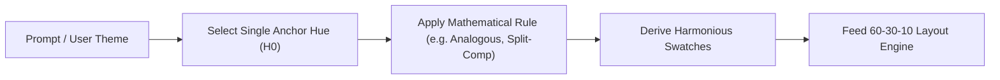

# Parametric Color Architecture & Guardrails for AI Agents

To prevent AI coding and design agents (e.g., Model Context Protocol / MCP tools, Claude, GPT, Codex) from hallucinating harsh, clashing, or illegible hex/RGB colors, **remove their ability to invent raw colors entirely**.

> [!IMPORTANT]
> **LLMs do not perceive color—they predict text tokens.**
> Letting an agent emit arbitrary `#RRGGBB` strings or raw `Color(r, g, b)` floats guarantees inconsistent, unpolished UI. Instead, constrain agent interactions to **parametric color math (HSV/HSL)**, **structural distribution rules**, and **semantic design tokens**.

---

## 1. Shift from RGB / Hex to Perceptual HSV (or HSL / OKLCH)

RGB channels lack perceptual uniformity: tweaking one channel shifts hue, saturation, and luminance simultaneously. All agent-facing schemas, design rules, and Unity conversions must operate in **HSV** (`UnityEngine.Color.HSVToRGB`):

$$\text{Color} = f(H, S, V) \quad \text{where} \quad H \in [0^\circ, 360^\circ], \; S \in [0, 1], \; V \in [0, 1]$$

* **Hue ($H \in [0^\circ, 360^\circ]$):** The base color family (e.g., $210^\circ$ for blue, $145^\circ$ for emerald).
* **Saturation ($S \in [0\%, 100\%]$):** Chromatic intensity and purity.
* **Value / Brightness ($V \in [0\%, 100\%]$):** Relative lightness and luminance.

### Strict Agent Guardrails for HSV

1. **Ban Pure Extremes:**
   * Never allow $S = 100\%$ combined with $V = 100\%$ (creates eye-straining, garish neon colors).
   * Cap general UI saturation between **$60\% \text{ and } 85\%$**.
2. **Ban Pure Black and Pure White:**
   * Replace `#000000` with dark, desaturated surface tones:
     $$V \in [8\%, 15\%], \quad S \in [5\%, 15\%]$$
   * Replace `#FFFFFF` with soft off-whites:
     $$V \in [92\%, 98\%], \quad S \in [2\%, 5\%]$$
3. **Tinted Neutrals (Chromatically Cohesive Surfaces):**
   * Force background panels, card surfaces, and borders to inherit the primary anchor hue:
     $$H_{\text{neutral}} = H_{\text{primary}}, \quad S \in [4\%, 12\%]$$
   * Prevents the UI from looking like colored shapes pasted onto dead, disconnected gray backdrops.

---

## 2. Structural & Mathematical Color Harmony Rules

Instead of allowing the agent to pick $N$ random colors, force it to select **one Anchor Hue ($H_0$)** derived from the design prompt (e.g., $210^\circ$ for sci-fi HUD, $140^\circ$ for fantasy nature), and calculate the rest mathematically:

| Harmony Mode | Formula from Anchor Hue ($H_0$) | Best Unity Game UI Use Case |
| :--- | :--- | :--- |
| **Monochromatic** | $H_0 \text{ fixed}; \; \Delta S \in [\pm 20\%], \; \Delta V \in [\pm 30\%]$ | Minimalist HUDs, inventory matrices, clean stats cards |
| **Analogous** | $H_0, \; (H_0 + 30^\circ) \bmod 360^\circ, \; (H_0 - 30^\circ) \bmod 360^\circ$ | Fantasy menus, cohesive skill trees, peaceful ambient dialogs |
| **Complementary** | $H_0 \text{ (base)}, \; (H_0 + 180^\circ) \bmod 360^\circ \text{ (accent)}$ | High-visibility CTAs, Player vs. Enemy indicators |
| **Split-Complementary** | $H_0, \; (H_0 + 150^\circ) \bmod 360^\circ, \; (H_0 + 210^\circ) \bmod 360^\circ$ | Rich RPG/Action HUDs where pure complementary is too jarring |
| **Triadic** | $H_0, \; (H_0 + 120^\circ) \bmod 360^\circ, \; (H_0 + 240^\circ) \bmod 360^\circ$ | Arcade/Casual games, multi-faction UI, rarity tiers |



---

## 3. Core Design Principles for System Prompts & MCP Rules

Embed these four operational guardrails directly into your agent system prompts and rules:

### A. The 60-30-10 Distribution Rule
Every generated component hierarchy must strictly adhere to visual weight distribution:

* **60% Dominant (Backdrops / Screen Backgrounds / Outer Containers):**
  * Low saturation ($S < 15\%$).
  * Dark Mode: $V \in [10\%, 22\%]$ | Light Mode: $V \in [90\%, 98\%]$.
* **30% Secondary (Cards / Panels / Inactive Tabs / Nested Rows):**
  * Mid-low saturation ($S \in [15\%, 35\%]$).
  * Stepped brightness ($+8\% \text{ to } +12\% \; V$ above background) to ensure clean elevation separation.
* **10% Accent (Call to Action / Health / Interactive Focal Points):**
  * High saturation ($S \in [70\%, 90\%]$), high brightness ($V \in [80\%, 95\%]$).
  * Reserved strictly for actionable or high-priority elements.

### B. Contrast & Readability (WCAG / Luminance Checks)
Text and icons must never disappear into parent containers:
* Enforce a minimum Value delta ($\Delta V \ge 50\%$) between foreground text/glyphs and underlying surfaces.
* Calculate relative luminance $L$ in C# and dynamically flip text between light and dark when the contrast ratio is below **4.5:1**:
  $$L = 0.2126 \cdot R + 0.7152 \cdot G + 0.0722 \cdot B$$

### C. Fixed Functional Semantic Colors (Never Randomize)
The agent must **never** apply harmony variations to functional game feedback. Lock these semantic hues globally:

* **Success / Confirm / Buff:** Green ($H \in [135^\circ, 155^\circ]$)
* **Warning / Alert / Gold:** Amber/Yellow ($H \in [35^\circ, 50^\circ]$)
* **Danger / Health / Error / Destructive:** Red/Crimson ($H \in [350^\circ, 10^\circ]$)
* **Info / Mana / Stamina:** Cyan/Blue ($H \in [195^\circ, 220^\circ]$)

### D. Deterministic Interactive State Offsets (Button / Toggle Math)
When generating `Selectable` or `Button` `ColorBlock` states in Unity, never let the agent invent 4 separate colors. Compute them deterministically from the primary state:

$$\begin{aligned}
\text{Normal} &= (H, \; S, \; V) \\
\text{Hover / Highlighted} &= \left(H, \; \max(0, S - 0.05), \; \min(1.0, V + 0.10)\right) \\
\text{Pressed} &= \left(H, \; \min(1.0, S + 0.05), \; \max(0, V - 0.12)\right) \\
\text{Disabled} &= \left(H, \; S \times 0.25, \; V \times 0.60\right) \quad \text{with } \alpha = 0.50
\end{aligned}$$

---

## 4. Architectural Fix: Constrain Your MCP Tool Schema

The most foolproof defense is schema-level restriction: **strip raw hex string parameters from MCP component tools**.

### ❌ Anti-Pattern: Unconstrained Free-Text Hex Inputs
Allows the agent to hallucinate arbitrary colors:
```json
{
  "name": "create_ui_button",
  "description": "Prone to hallucinated, unharmonized colors",
  "parameters": {
    "type": "object",
    "properties": {
      "backgroundColorHex": { "type": "string" },
      "textColorHex": { "type": "string" }
    },
    "required": ["backgroundColorHex", "textColorHex"]
  }
}
```

### ✅ Best Practice: Semantic Role & Token-Based Tool Schema
Constrains the agent to semantic tokens that resolve via the Unity theme engine:
```json
{
  "name": "create_ui_component",
  "description": "Constructs UI with guaranteed color harmony",
  "parameters": {
    "type": "object",
    "properties": {
      "componentType": { 
        "type": "string", 
        "enum": ["Panel", "Card", "Button", "Label", "Slider", "Badge"] 
      },
      "colorRole": { 
        "type": "string", 
        "enum": [
          "SurfaceBase", 
          "SurfaceElevated", 
          "PrimaryAccent", 
          "SecondaryAccent", 
          "SemanticDanger", 
          "SemanticSuccess", 
          "TextPrimary", 
          "TextMuted"
        ] 
      },
      "elevationLevel": { 
        "type": "integer", 
        "minimum": 0, 
        "maximum": 3 
      }
    },
    "required": ["componentType", "colorRole"]
  }
}
```

### ✅ Parametric Theme Generator Tool
When dynamic theme generation is required, allow the agent to pass only high-level mathematical parameters:
```json
{
  "name": "generate_color_theme",
  "description": "Generates a fully mathematically harmonized palette",
  "parameters": {
    "type": "object",
    "properties": {
      "themeName": { "type": "string" },
      "baseHue": { "type": "number", "minimum": 0, "maximum": 360 },
      "harmonyRule": { 
        "type": "string", 
        "enum": ["Monochromatic", "Analogous", "Complementary", "SplitComplementary", "Triadic"] 
      },
      "isDarkMode": { "type": "boolean", "default": true }
    },
    "required": ["themeName", "baseHue", "harmonyRule"]
  }
}
```

---

## 5. Unity C# Reference Implementation

Below is the zero-dependency C# generator calculating the 60-30-10 surfaces, contrast text, and interactive button states deterministically:

```csharp
using UnityEngine;

namespace UIQualityLife.Styling
{
    public static class ParametricColorEngine
    {
        public struct GeneratedTheme
        {
            public Color SurfaceBackground; // 60%
            public Color SurfaceCard;       // 30%
            public Color PrimaryAccent;     // 10%
            public Color SecondaryAccent;
            public Color TextPrimary;
            public Color TextMuted;
        }

        public static GeneratedTheme CreateTheme(float baseHue, string harmonyRule, bool isDarkMode = true)
        {
            float h0 = Mathf.Repeat(baseHue, 360f) / 360f;
            GeneratedTheme theme = new GeneratedTheme();

            if (isDarkMode)
            {
                // 60% Background: Desaturated, tinted surface
                theme.SurfaceBackground = Color.HSVToRGB(h0, 0.08f, 0.12f);
                // 30% Card: Slightly elevated brightness & saturation
                theme.SurfaceCard = Color.HSVToRGB(h0, 0.12f, 0.19f);
                // Text
                theme.TextPrimary = Color.HSVToRGB(h0, 0.02f, 0.95f);
                theme.TextMuted = Color.HSVToRGB(h0, 0.06f, 0.65f);
            }
            else
            {
                theme.SurfaceBackground = Color.HSVToRGB(h0, 0.04f, 0.96f);
                theme.SurfaceCard = Color.HSVToRGB(h0, 0.06f, 0.99f);
                theme.TextPrimary = Color.HSVToRGB(h0, 0.10f, 0.12f);
                theme.TextMuted = Color.HSVToRGB(h0, 0.08f, 0.45f);
            }

            // 10% Accent: Pure, vibrant focal point
            theme.PrimaryAccent = Color.HSVToRGB(h0, 0.78f, 0.88f);

            // Compute Secondary Accent via Harmony Rule
            float hSecondary = h0;
            switch (harmonyRule?.ToLowerInvariant())
            {
                case "complementary":
                    hSecondary = Mathf.Repeat(h0 + 0.5f, 1.0f);
                    break;
                case "analogous":
                    hSecondary = Mathf.Repeat(h0 + (30f / 360f), 1.0f);
                    break;
                case "splitcomplementary":
                    hSecondary = Mathf.Repeat(h0 + (150f / 360f), 1.0f);
                    break;
                case "triadic":
                    hSecondary = Mathf.Repeat(h0 + (120f / 360f), 1.0f);
                    break;
                default: // Monochromatic
                    hSecondary = h0;
                    break;
            }

            theme.SecondaryAccent = Color.HSVToRGB(hSecondary, 0.65f, 0.80f);
            return theme;
        }

        public static UnityEngine.UI.ColorBlock ComputeButtonColors(Color baseColor)
        {
            Color.RGBToHSV(baseColor, out float h, out float s, out float v);

            var cb = UnityEngine.UI.ColorBlock.defaultColorBlock;
            cb.normalColor = baseColor;
            cb.highlightedColor = Color.HSVToRGB(h, Mathf.Max(0f, s - 0.05f), Mathf.Min(1f, v + 0.10f));
            cb.pressedColor = Color.HSVToRGB(h, Mathf.Min(1f, s + 0.05f), Mathf.Max(0f, v - 0.12f));
            cb.disabledColor = new Color(baseColor.r, baseColor.g, baseColor.b, 0.5f) * 0.6f;
            cb.colorMultiplier = 1f;
            cb.fadeDuration = 0.1f;
            return cb;
        }

        public static float GetRelativeLuminance(Color c)
        {
            return 0.2126f * c.r + 0.7152f * c.g + 0.0722f * c.b;
        }
    }
}
```
